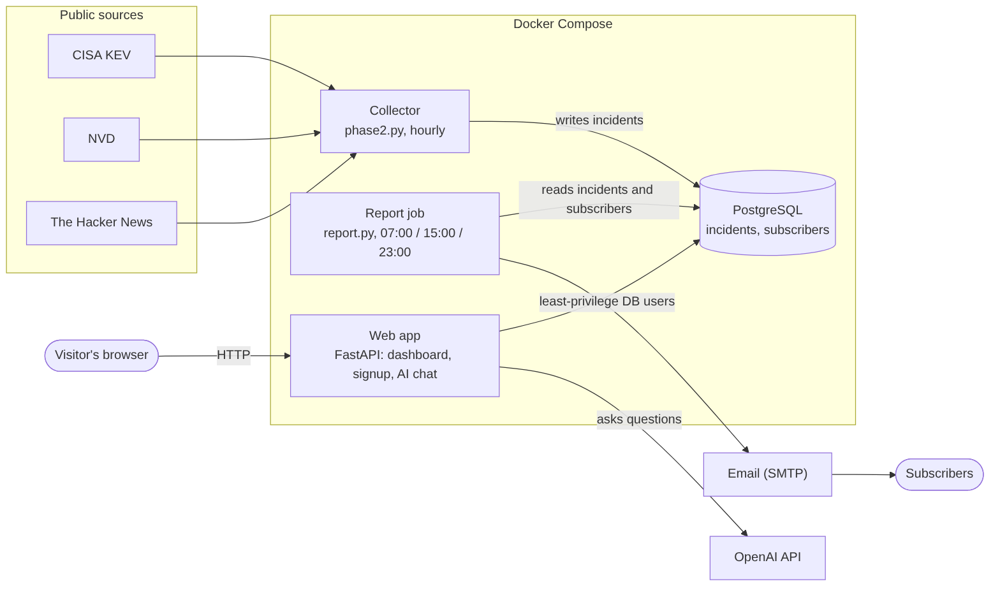
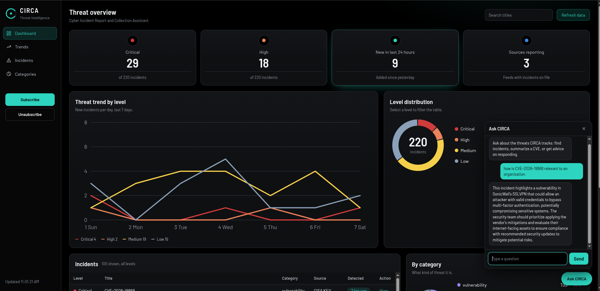
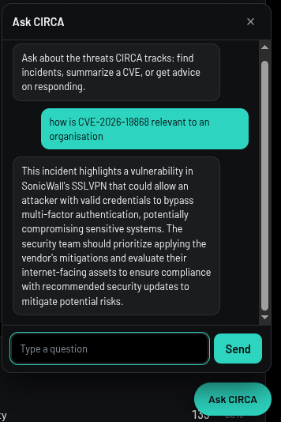

# CIRCA

**Cyber Incident Report & Collection Assistant**

CIRCA is a threat-intelligence tool that automatically gathers public cybersecurity news and vulnerability data, stores it, emails it to subscribers, shows it on a dashboard, and answers questions about it through an AI chat.

## What it does

- Collects security incidents and vulnerabilities from public sources (CISA's Known Exploited Vulnerabilities list, the NVD vulnerability database and The Hacker News feed) every hour
- Stores them in a PostgreSQL database
- Emails a summary report to subscribers three times a day (07:00, 15:00 and 23:00)
- Has a dashboard where you can see live statistics, browse recent incidents and search them
- Has an AI chat where you can ask questions about the collected incidents in plain English

## How it works

   

   - The **collector** runs every hour, reads the public sources and saves new incidents in the database.
   - The **report job** emails a summary to subscribers three times a day.
   - The **web app** serves the dashboard, the signup and unsubscribe pages and the AI chat. It connects to the database as separate users, each allowed to do only its own job.

## Screenshots






## How to run it

You need Docker and Docker Compose.

1. Get the code:

   ```
   git clone https://github.com/Ayomiposi224/Circa.git
   cd Circa
   ```

2. Create your settings file and fill in your own values. Make each password long and random, for example with `openssl rand -hex 24`:

   ```
   cp .env.example .env
   ```

   `.env` holds passwords and API keys. It is never committed to Git.
   
   For a local run, set CIRCA_BASE_URL to http://127.0.0.1:8000.

   The dashboard works without an OpenAI key and mail login, but the AI chat will report that it is unavailable and no emails will be sent.
   
3. Start the database and wait until it is ready:

   ```
   docker compose up -d db
   ```
   Check that it says `healthy`:

   ```
   docker compose ps
   ```

4. Create the database users and tables:

   ```
   docker compose exec -T db psql -U postgres -d cyberwatch -v ON_ERROR_STOP=1 < roles.sql
   docker compose exec -T db psql -U postgres -d cyberwatch -v ON_ERROR_STOP=1 < schema.sql
   ```

5. Set the database users' passwords from your `.env`:

   ```
   sh set-passwords.sh
   ```

6. Start the app:

   ```
   docker compose up -d --build
   ```

7. Open the dashboard at http://127.0.0.1:8000


## Security

CIRCA was built with security in mind from the start. Here is what is in place.

**Secrets**
- Passwords and API keys live only in `.env`, which is excluded from Git. The repo contains `.env.example`, which lists variable names with no values.
- Every push and pull request is scanned for leaked secrets with Gitleaks.

**Database**
- The app never connects as an admin. Five separate database users each have only the permissions their job needs, down to single columns. For example, the signup user can add an email address but cannot read other people’s email addresses.
- The AI chat runs its queries as a read-only database user. The generated SQL must also start with `SELECT`, include a `LIMIT`, and pass a keyword blocklist before it runs. The database permissions are the real safeguard: even if a bad query got through, that user cannot change data.

**Containers**
- The app runs as a non-root user inside its container.
- The web port is bound to `127.0.0.1` only, and the database port is not published at all.
- A `.dockerignore` allowlist keeps files that should not be in the image out of it.

**Abuse limits**
- The AI chat is rate limited to 10 questions per 10 minutes per visitor, and 200 per day overall, to prevent abuse and protect API credit.

**Automated checks (GitHub Actions)**
Run on every push and pull request, and weekly:
- Gitleaks scans the full Git history for secrets.
- `pip-audit` checks dependencies for known vulnerabilities.
- Bandit scans the Python code for risky patterns. One reviewed false positive is recorded in `bandit-baseline.json`, so any new finding fails the check.

Dependabot proposes updates for Python packages, the Docker image and GitHub Actions.

**Known limitations**
- There are no automated functional tests yet; the checks above cover security only.
- The AI query check is a simple keyword blocklist. The read-only database user is what actually prevents changes.
- GitHub Actions are pinned by version tag, not by commit hash.
- Docker image vulnerability scanning is not set up yet.
- Branch protection is not enabled yet.
